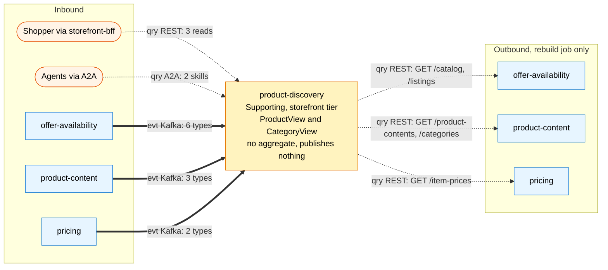

# Bounded context canvas

Following the ddd-crew [Bounded Context Canvas v5](https://github.com/ddd-crew/bounded-context-canvas). This
is a **read-only context**: no command arrives, no event leaves. Messages are taken from the code and the
specs on this branch.

## Canvas at a glance

Source: `internal/adapters/inbound/{http,kafka,a2a}`, `internal/adapters/outbound/sources`,
`docs/network-ohs-allowlist.yaml`, `apis/*.yaml`.

## Name

**Product Discovery** (`product-discovery`, code `PD`, CloudEvents tier `storefront`).

## Purpose

The read side of browsing and search. One **ProductView** per catalogue item (title, flags, content, category
path, list and effective price, `inStock`, `purchasable`) and one **CategoryView** (the browsable tree plus
purchasable counts), fed by events from `offer-availability`, `product-content` and `pricing`, searched with
PostgreSQL full-text search and `pg_trgm` behind a port.

## Strategic classification

| Axis | Verdict |
| --- | --- |
| Domain | **Supporting**, a Core candidate at scale ([Core domain chart](/docs/ddd/core-domain-chart)) |
| Business model | Conversion enabler: finding the right purchasable item fast |
| Evolution | Custom-built; the search engine slice is designed for swap |

## Domain roles

| Role | Applies? | Evidence |
| --- | --- | --- |
| Analysis (search and browse) | Yes, primary | the projections and the search behaviour |
| Gateway (the storefront's catalogue reads) | Yes | the only shopper-facing catalogue surface: the three REST reads, mirrored by two A2A skills |
| Execution | No | no command, no state machine |
| Specification | No | prices, content and availability are the upstreams' facts |

## Inbound communication

| Collaborator | Message | Type | Channel | Relationship |
| --- | --- | --- | --- | --- |
| `storefront-bff` | `SearchProducts`, `GetProduct`, `ListCategories` | Query | REST `GET /products`, `GET /products/{catalogItemId}`, `GET /categories` | Open Host Service (this context is the host) |
| agents | `search_products`, `get_product` | Query | A2A JSON-RPC 2.0 on `/` and `/a2a` | Open Host Service (delegation channel, ADR 0007) |
| `offer-availability` | `CatalogItemCreated`, `CatalogItemDiscontinued`, `ListingCreated`, `ListingAvailabilityChanged`, `ListingSuppressed`, `ListingRestored` | Event | Kafka `retailnetwork.offer-availability.events` | Conformist |
| `product-content` | `ProductContentPublished`, `ProductContentRetired`, `CategoryTreePublished` | Event | Kafka `retailnetwork.product-content.events` | Conformist |
| `pricing` | `ItemPriceChanged`, `ItemPriceWithdrawn` | Event | Kafka `retailnetwork.pricing.events` | Conformist |

## Outbound communication

| Collaborator | Message | Type | Channel | Relationship |
| --- | --- | --- | --- | --- |
| `offer-availability` | list catalogue | Query | REST `GET /catalog`, rebuild only | Customer/Supplier (the network's Open Host Service) |
| `offer-availability` | list listings | Query | REST `GET /listings`, rebuild only, ops-only in-org read, never on a user request | documented exception (`TestNoInOrgNetworkRoute`) |
| `pricing` | list item prices | Query | REST `GET /item-prices`, rebuild only | Customer/Supplier |
| `product-content` | list contents, list categories | Query | REST `GET /product-contents`, `GET /categories`, rebuild only | Customer/Supplier |

No event is published: no `retailnetwork.product-discovery.events` topic, no analytics topic. The only thing
written to Kafka is the dead-letter record. Payloads: [Domain events](/docs/ddd/domain-events).

## Ubiquitous language

Top terms: **Purchasable**, **Product View**, **Category View**, **In Stock**, **Stub**, **Monotonic guard**,
**Product-type query**. Full glossary: [Ubiquitous language](/docs/ddd/ubiquitous-language).

## Business decisions

1. **No aggregate in v1: projections only** ([ADR 0002](/docs/adr/0002-product-discovery-assumptions)). A wrong
   projection is rebuilt, not corrected by hand.
2. **Fixed ranking:** `tsvector` weights title A, category names A (a query-time boost), attributes B,
   description and bullets C; `pg_trgm` is the typo fallback; facets are category, price band and in-stock.
3. **Product-type queries also return category suggestions**: categories whose name covers every query word,
   shallowest first, at most 5.
4. **Out-of-order safety comes from per-source monotonic guards** (listing `asOf`, content `revision`, price
   `version`, tree `version`) on top of the CloudEvents-id inbox.
5. **Bootstrap is snapshot plus catch-up** ([ADR 0003](/docs/adr/0003-consumed-contracts-and-rebuild),
   [ADR 0006](/docs/adr/0006-rebuild-as-default-off-helm-job)): the rebuild job folds the producers' paged
   reads through the same rules; the consumers resume from their committed offsets.

Policies: **PurchasableRule** (`View.Purchasable`) and **UnavailableNotBuyable** (a row that is not
purchasable is still shown, flagged; out-of-stock purchase is impossible in this network).

## Assumptions

The assumptions A1 to A18 are in [ADR 0002](/docs/adr/0002-product-discovery-assumptions). The ones that shape
behaviour most: a suppress or restore for an unknown listing is skipped (A1); a stub is invisible (A2); a
category filter covers the subtree (A3); price sorts and filters skip unpriced rows (A14); price bands are
configurable (A15); a rebuild never rewinds a known listing state (A16).

## Verification metrics

| Metric | Source on this branch |
| --- | --- |
| Searches by outcome (`served`, `empty`, `failed` with reason) | `discovery.searches.served` ([Observability](/docs/operations/observability)) |
| Request duration by route | `http.server.request.duration` |
| Consumer lag of the three groups, dead-letter depth | Kafka tooling; not exported by the service |
| Guard regressions (an older fact overwriting a newer one) | 0 by construction; pinned by the fold tests and the godog suite |
| Inbox duplicates acknowledged | `processed_events` rows |
| Rebuild counters | the `rebuild finished` log line |

No latency targets are enforced in code; the Kong SLO alerts in `warehouse-infra` use 99 % availability and
95 % under 500 ms on the edge route.

## Open questions

- **No search analytics.** Nothing is published, so query terms, zero-result and fallback rates are
  unobservable downstream; only the `discovery.searches.served` counter exists.
- **Silent staleness.** There is no freshness metric and no alert on consumer lag or a silent topic.
- **Unbounded growth.** `processed_events` and the dead-letter topics have no pruning job.
- **The listing snapshot is an in-org read.** `GET /listings` has no storefront OHS equivalent; the exception
  is allowed only on the rebuild path.
