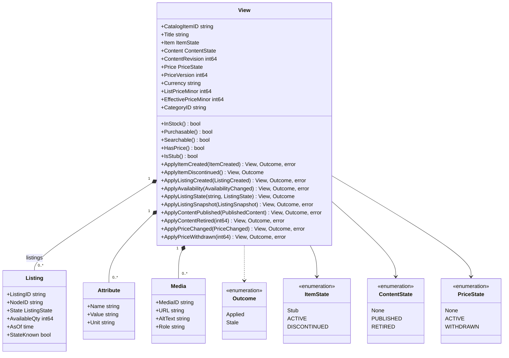
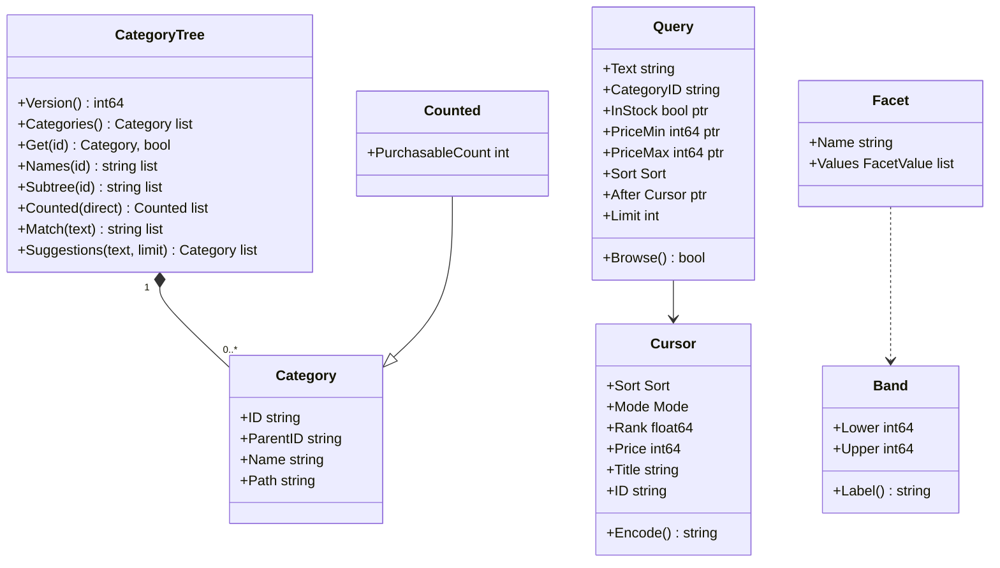
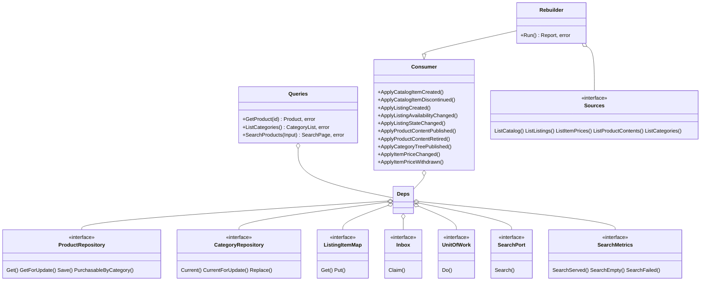
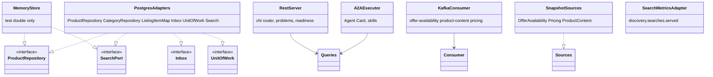

# Class diagram

UML class diagrams of the read-side model and of the hexagonal ports and the adapters that implement them.
Go has no classes: a box is a struct or an interface, a method is a function with that receiver. Only the
types and members that carry meaning are drawn.

## Domain: ProductView and its value types

Source: `internal/domain/productview/view.go`, `fold_item.go`, `fold_listing.go`, `fold_content.go`,
`fold_price.go`.

## Domain: CategoryView and search

Source: `internal/domain/categoryview/categoryview.go`, `internal/domain/search/{query,cursor,bands,facets}.go`.
`CategoryTree` is `categoryview.View`, renamed here to avoid a clash with `productview.View`.

## Application: ports and use cases

Source: `internal/application/usecases/*.go`, `internal/application/ports/ports.go`.
`Sources` groups the four snapshot ports (`CatalogSource`, `ListingSource`, `PriceSource`, `ContentSource`).

## Adapters

Source: `internal/adapters/outbound/postgres/`, `internal/adapters/outbound/memory/`,
`internal/adapters/inbound/{http,a2a,kafka}/`, `internal/adapters/outbound/{sources,telemetry}/`. The memory
adapters are shared by the unit tests and the godog suite; `TestRuntimeBinaryHasNoInMemoryAdapters` keeps them
out of the binaries. One contract suite (`internal/adapters/outbound/repocontract`) runs against both the
memory store and Postgres.
