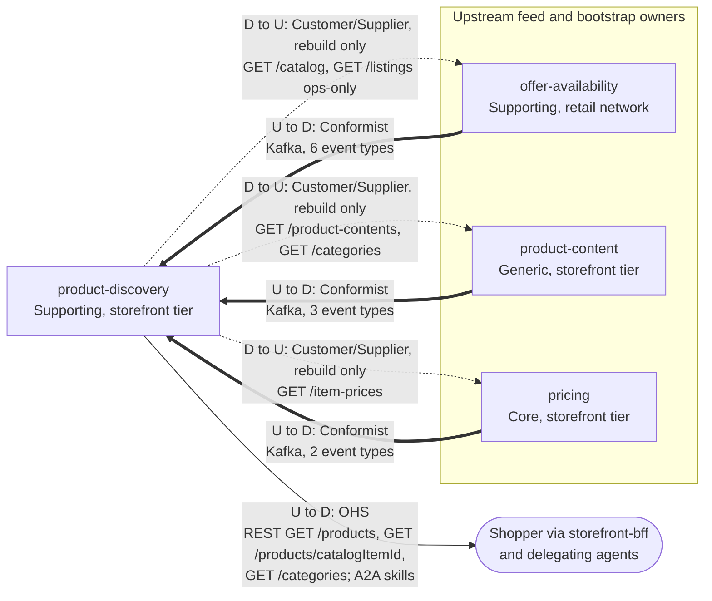

# Context map

Following ddd-crew [Context Mapping](https://github.com/ddd-crew/context-mapping). This is
`product-discovery`'s slice of the
[storefront-wide context map](https://iqvo.github.io/warehouse-docs/storefront/strategic-design/context-map):
every relationship the context has, with the upstream (U) and downstream (D) side, the pattern and the channel.

Source: `cmd/api/workers.go` (the three consumers), `internal/adapters/inbound/http/server.go` (routes),
`internal/adapters/inbound/a2a/server.go` (skills), `internal/adapters/outbound/sources/` and
`docs/network-ohs-allowlist.yaml` (rebuild reads).

Thick arrows are Kafka event relationships, solid arrows synchronous reads. The dotted arrows are this
context's own calls, the downstream customer reading its upstream supplier; they exist only on the ops-run
rebuild, never on a shopper request. REST path parameters are written without braces inside the diagram.

## Relationships

| Neighbour | Direction | Pattern | Channel | Messages | Why this pattern |
| --- | --- | --- | --- | --- | --- |
| `storefront-bff` (experience layer) | PD upstream, shopper downstream | **Open Host Service** | REST `GET /products`, `GET /products/{catalogItemId}`, `GET /categories` | `SearchProducts`, `GetProduct`, `ListCategories` | The whole catalogue surface of the storefront edge is these three reads; the BFF needs no knowledge of the feeds. No authentication |
| delegating agents | PD upstream | **Open Host Service** | A2A JSON-RPC on `/` and `/a2a` | skills `search_products`, `get_product` | The same two reads as agent skills ([ADR 0007](/docs/adr/0007-a2a-inbound-adapter)) |
| `offer-availability` (network) | OA upstream, PD downstream | **Conformist** | Kafka `retailnetwork.offer-availability.events` | six item and listing events | The item master and listing availability are the network's language; the context keeps only what the join needs |
| `product-content` | PC upstream, PD downstream | **Conformist** | Kafka `retailnetwork.product-content.events` | `ProductContentPublished`, `ProductContentRetired`, `CategoryTreePublished` | Same-shape sibling feed: revision, full content and the whole tree per version |
| `pricing` | PR upstream, PD downstream | **Conformist** | Kafka `retailnetwork.pricing.events` | `ItemPriceChanged`, `ItemPriceWithdrawn` | The effective price is pricing's fact; the context copies prices and the `version` guard |
| `offer-availability` | OA supplier, PD customer | **Customer/Supplier** | REST `GET /catalog`; `GET /listings` | list catalogue; list listings | Rebuild only. `GET /catalog` is an Open Host Service route; `GET /listings` has no storefront read, so it is an in-org read on an ops-only path, the one documented exception |
| `pricing` | PR supplier, PD customer | **Customer/Supplier** | REST `GET /item-prices` (paged) | list item prices | Rebuild only: prices before the events begin |
| `product-content` | PC supplier, PD customer | **Customer/Supplier** | REST `GET /product-contents` (paged), `GET /categories` | list contents; list categories | Rebuild only: published content and the tree before the events begin |

## Notes on the patterns

- **No anti-corruption layer.** All three feeds are inside one organisation and publish a stable CloudEvents
  contract; conforming is cheap. The monotonic guards order facts, they do not translate them.
- **Conformist on the feeds.** The feeds are published facts, not negotiated interfaces; the context applies
  them as published and ignores unknown fields.
- **No shared kernel.** `catalogItemId`, `listingId` and `categoryId` are values copied from messages, never
  shared code or tables.
- **Open Host Service in one direction only.** The context hosts the shopper-facing reads and is a customer of
  every synchronous call it makes.
- **Nothing downstream but the shopper.** It publishes nothing, so no bounded context depends on it; the read
  side can be rebuilt, reindexed or swapped behind `SearchPort` without a neighbour noticing.
- **Separate Ways** with `shopping-cart`, `checkout` and `customer-payments`: the cart keeps its own
  purchasability view from the same feeds rather than calling this context.
- **No fleet edge.** The context never consumes a `warehouse.*` topic and never calls a warehouse-systems
  service.
