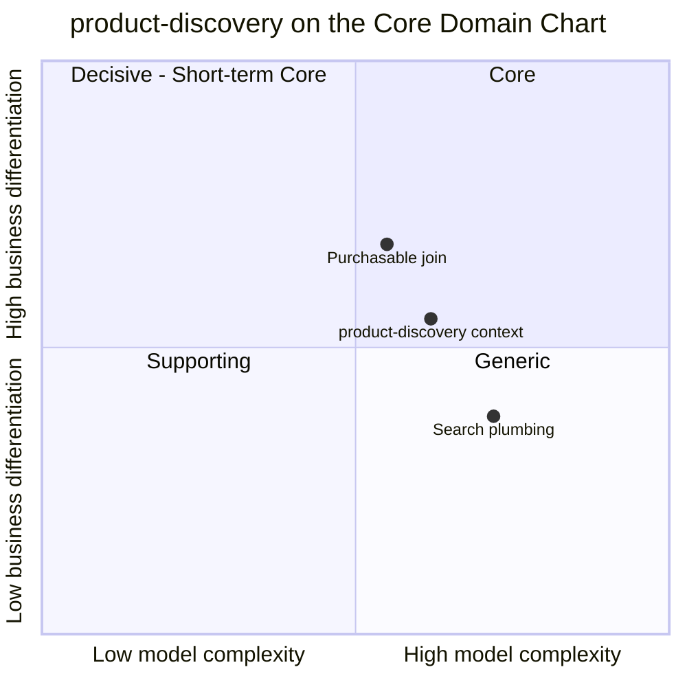

# Core domain chart

Following the ddd-crew [Core Domain Charts](https://github.com/ddd-crew/core-domain-charts): business
differentiation (y) against model complexity (x). The storefront-wide verdicts are on the
[storefront classification](https://iqvo.github.io/warehouse-docs/storefront/strategic-design/subdomain-classification);
the reasoning for this context is on [Subdomain classification](/docs/ddd/subdomain-classification).

Source: the context's point (complexity 0.62, differentiation 0.55) is the storefront model's
(`model.yaml`, `contexts[product-discovery].chart`, held by the aggregator); the two slices are placed by
judgement against `internal/domain/productview/view.go` (`Purchasable`) and
`internal/adapters/outbound/postgres/search.go` (the search SQL).

## Classification: Supporting

The context's point sits just over both midlines, the corner the chart labels Core. The verdict is
nevertheless **Supporting** ("Core candidate at scale; the engine itself is generic"). The two slices show why
the point straddles the midline:

- The **purchasable join** (upper slice) is the storefront's own work: four facts from three producers (item
  `ACTIVE`, content `PUBLISHED`, price `ACTIVE`, a `LIVE` listing with stock) in one row that no upstream
  owns. It is why a search hit is buyable the moment it is visible.
- The **search plumbing** (lower slice) is not: full-text search over a weighted `tsvector`, a `pg_trgm`
  fallback and three fixed facets are what every search stack does, which is why the engine sits behind
  `ports.SearchPort` ([Class diagram](/docs/ddd/class-diagram)).

**Differentiation is moderate (0.55).** No shopper chooses the storefront for its ranking: the weights are
fixed (title A, category names A, attributes B, description C). The differentiator is *what* is ranked:
purchasable items first, with the honest "currently unavailable" verdict on the rest.

**Complexity is the highest of the storefront's read-side packs (0.62).** Not because of rules (there is no
aggregate, no state machine, no domain error) but because of the plumbing: three consumed topics, eleven event
types, four monotonic guards, a search index to keep coherent with the projections and a snapshot rebuild that
touches three producers.

## Business model and evolution

**Conversion enabler**: the context earns nothing directly; its value is the search session it does not lose.

| Part | Evolution | Why |
| --- | --- | --- |
| Projections (`productview`, `categoryview`, the guards) | Custom-built | The purchasable join is this storefront's own; no product ships it |
| Search (`tsvector`, `pg_trgm`, facets) | Designed for swap | `SearchPort` makes a dedicated engine an adapter swap, not a rewrite |
| Plumbing (inbox, CloudEvents consumers, dead letters) | Commodity | Fleet-wide building blocks |

**Movement to watch.** What moves the context up is volume, not new rules: if catalogue and query volume grow
past one PostgreSQL search path, the engine slice is swapped behind the port and the context is reclassified.
Until then investment stays capped: no dedicated engine, no ranking team, no search analytics (nothing is
published).
