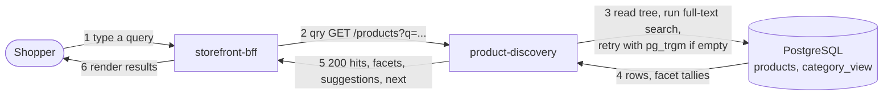
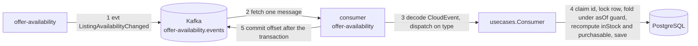
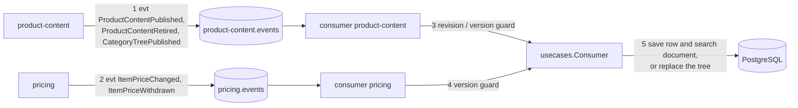
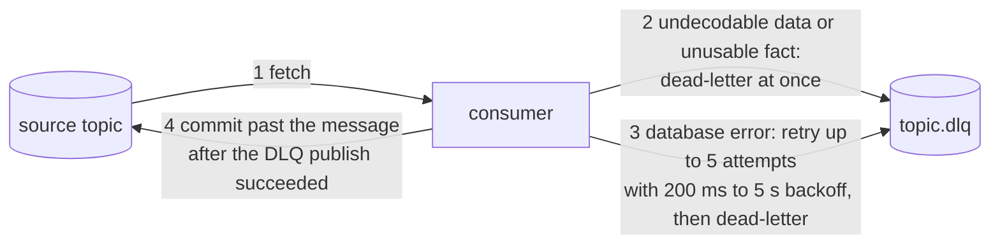
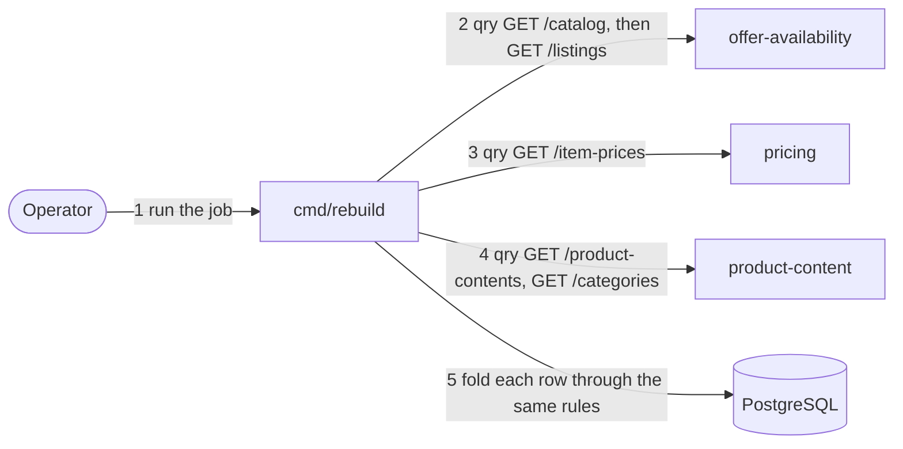

# Domain message flow

Following [Domain Message Flow Modelling](https://github.com/ddd-crew/domain-message-flow-modelling): the key
scenarios as numbered flows of queries (`qry`) and events (`evt`) across contexts. There is **no command** in
this context and no event leaves it. Detailed step-by-step interactions are on
[Sequence diagrams](/docs/ddd/sequence-diagrams).

## 1. Shopper search

Source: `internal/application/usecases/queries.go`, `internal/adapters/inbound/http/handlers.go`.

## 2. The availability feed

Source: `internal/adapters/inbound/kafka/offer_availability.go`, `internal/application/usecases/consume_offer.go`.

## 3. The content, tree and price feeds

Source: `internal/adapters/inbound/kafka/{product_content,pricing}.go`, `internal/application/usecases/consume_catalogue.go`.

## 4. A message that cannot be applied

Source: `internal/adapters/inbound/kafka/consumer.go`, `kafka.go`, `deadletter.go`.

## 5. Bootstrap rebuild

Source: `internal/application/usecases/rebuild.go`, `internal/adapters/outbound/sources/`.
Afterwards the live consumers resume from their committed offsets; the per-source guards drop every replayed
event that is not newer than the snapshot.

## 6. Agent delegation

An agent sends a skill request to `cmd/a2a` (`search_products` or `get_product`). The adapter maps it to the
same `Queries` use case as REST and answers in the reply message; domain rejections are problems inside the
envelope, never JSON-RPC errors. No other context is involved.

Source: `internal/adapters/inbound/a2a/skills.go`.
