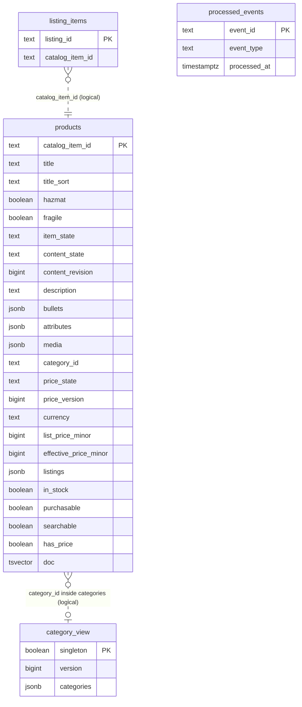

# Entity relationship

The Postgres schema as created by the single embedded migration `0001_product_discovery_schema` (up and down).
There are four tables and the `pg_trgm` extension; no foreign key exists, the links between tables are logical
(the projections are rebuilt from events, so referential integrity is not enforced by the database).

Source: `internal/adapters/outbound/postgres/migrations/0001_product_discovery_schema.up.sql` and `.down.sql`.

## Tables

| Table | Holds | Written by |
| --- | --- | --- |
| `products` | One row per catalogue item, including stubs (empty `title` and `item_state`). The listings of the item are a JSONB array (`listingId`, `nodeId`, state, quantity, `asOf`) ordered by listing id. `in_stock`, `purchasable`, `searchable` and `has_price` are derived by the fold rules and stored so search can filter and sort on them. `doc` is the weighted search document: title A, attributes B, description and bullets C. Category names are not in it: they are matched at query time | `Consumer` folds, `Rebuilder` |
| `category_view` | The one published category tree: `singleton` is always true (a `CHECK` forces one row), `version` is the guard, `categories` is the whole tree as JSONB | `ApplyCategoryTreePublished`, `Rebuilder` |
| `listing_items` | The `ListingItemMap`: `listing_id` to `catalog_item_id`, a listing keeps its first item | listing events, `Rebuilder` |
| `processed_events` | The inbox: one row per applied CloudEvent `id` with its type and time. Never pruned | every fold, in the same transaction |

## Indexes

| Index | On | Serves |
| --- | --- | --- |
| `products_doc_idx` | GIN on `doc`, where `searchable` | full-text search |
| `products_title_trgm_idx` | GIN on `title gin_trgm_ops`, where `searchable` | the `pg_trgm` typo fallback |
| `products_category_idx` | `category_id`, where `searchable` | the category filter |
| `products_price_idx` | `effective_price_minor, catalog_item_id`, where `searchable AND has_price` | price sorts and bounds |
| `products_title_idx` | `title_sort COLLATE "C", catalog_item_id`, where `searchable` | `sort=title` |
| `products_purchasable_idx` | `category_id`, where `purchasable` | purchasable counts per category |

## Notes

- **No outbox, no relay table, no analytics table.** The context publishes nothing.
- **Stubs** are rows with `item_state = ''` and `title = ''`; every read treats them as absent.
- **Search weights and category names.** The `tsvector` has no category names (they would force a re-index on
  a rename); the search adds a query-time boost for products whose `category_id` is in the subtree of a
  category whose name covers the query words.
- **Rollback.** The `down` migration drops the four tables; `RollbackMigrations` exists for the up, down, up
  integration test only, no binary calls it.
- **Connection limits.** At most 10 pooled connections per process, each with `statement_timeout = 5s`.
