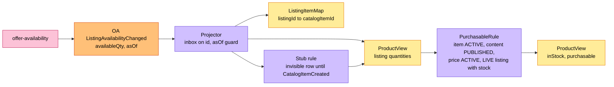
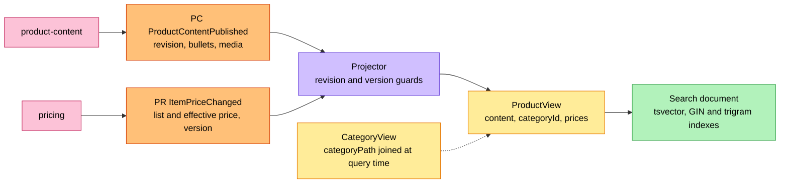
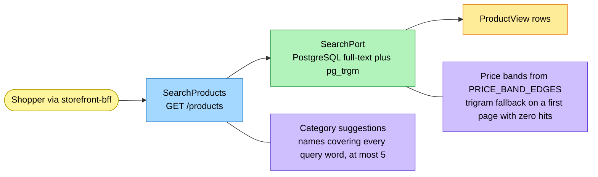
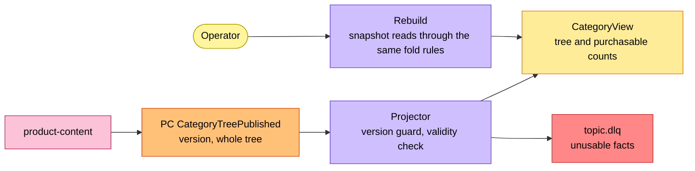

# EventStorming

Process-level boards in the ddd-crew
[EventStorming glossary and cheat sheet](https://github.com/ddd-crew/eventstorming-glossary-cheat-sheet)
notation, redrawn from the code on this branch. The context has **no command and no aggregate**, so the
classic command-aggregate-event chain appears only on the feed side: a neighbour's event enters, a *projector*
(drawn as a policy) folds it into a read model under a guard, and the verdict the shopper sees (`purchasable`)
is derived, never commanded into a state.

## Legend

| Colour | Sticky | Meaning here |
| --- | --- | --- |
| Pale yellow | Actor | The shopper (via the BFF), an agent, or the operator |
| Yellow | Read model | `ProductView`, `CategoryView`, `ListingItemMap` |
| Orange | Domain event | A neighbour's event (prefixed with the producer); none of our own |
| Lilac | Policy | The projector with its guard, `PurchasableRule`, the stub rule |
| Blue | Query | `SearchProducts`, `GetProduct`, `ListCategories` |
| Green | Search | The `SearchPort` and its index |
| Pink | External system | A sibling or network context |
| Red | Hotspot | A risk still open (table at the end) |

## 1. The availability feed

Source: `internal/application/usecases/consume_offer.go`, `internal/domain/productview/fold_listing.go`,
`view.go`.

The `ListingItemMap` is learned from `ListingCreated` and `ListingAvailabilityChanged` (both carry the item id)
and resolves `ListingSuppressed` and `ListingRestored`, which carry only `listingId`. There is no cross-key
ordering between `catalogitem.*` and `listing.*`, so a listing, price or content fact for an unknown item
upserts an invisible stub that `CatalogItemCreated` completes; the fold raises no error.

## 2. The content and price feeds

Source: `internal/application/usecases/consume_catalogue.go`, `internal/domain/productview/fold_content.go`,
`fold_price.go`.

`ProductView` stores `categoryId` only; the path is joined from `CategoryView` at query time, so
`CategoryTreePublished` never re-indexes product rows. `ProductContentRetired` and `ItemPriceWithdrawn` flip
the verdict to false and leave the row.

## 3. Shopper search

Source: `internal/application/usecases/queries.go`, `internal/domain/search/`.

## 4. Category tree, rebuild and dead letters

Source: `internal/domain/categoryview/categoryview.go`, `internal/application/usecases/rebuild.go`,
`internal/adapters/inbound/kafka/deadletter.go`.

## Hotspots

The model-time hotspots H1 to H8 were resolved in the design decisions and are all realised in the code
([ADR 0002](/docs/adr/0002-product-discovery-assumptions), [ADR 0003](/docs/adr/0003-consumed-contracts-and-rebuild)):

| # | Hotspot | Resolution in the code |
| --- | --- | --- |
| H1 | Suppress and restore carry only `listingId` | `ListingItemMap` (`listing_items`), learned from listing events; an unknown listing is skipped with a WARN |
| H2 | Bullets, media and list price missing from the declared fields | consumed and stored (`bullets`, `media`, `listPriceMinor`, `currency`) |
| H3 | A category rename would need a re-index | `ProductView` stores `categoryId` only; the path is joined at query time |
| H4 | No cross-key ordering | invisible stub rows; `CatalogItemCreated` completes them |
| H5 | Product-type detection | no detection rule: category suggestions are categories whose name covers every query word |
| H6 | Price-band edges, trigram trigger | edges `2500,5000,10000,25000` configurable by `PRICE_BAND_EDGES`; the trigram fallback fires on a first page with zero full-text hits |
| H7 | Snapshot shapes | the producers' paged reads carry the guard values (`asOf`, `revision`, `version`) that seed the guards |
| H8 | Which product-content reads the rebuild uses | `GET /product-contents` and `GET /categories` |

Open risks that remain, taken from the code:

| # | Hotspot | Where |
| --- | --- | --- |
| R1 | A silent producer or a stalled consumer leaves the read model stale with no metric or alert (no lag or freshness instrument) | [Observability](/docs/operations/observability) |
| R2 | `processed_events` and the dead-letter topics grow without a pruning job | [Runbook](/docs/operations/runbook#outbox-relay-and-sweepers) |
| R3 | A suppress or restore that arrives before its listing is known is dropped until a rebuild | `consume_offer.go` (`ApplyListingStateChanged`) |
| R4 | A producer that resets a `version` or `revision` counter has its new facts ignored as stale | `fold_price.go`, `fold_content.go` |
