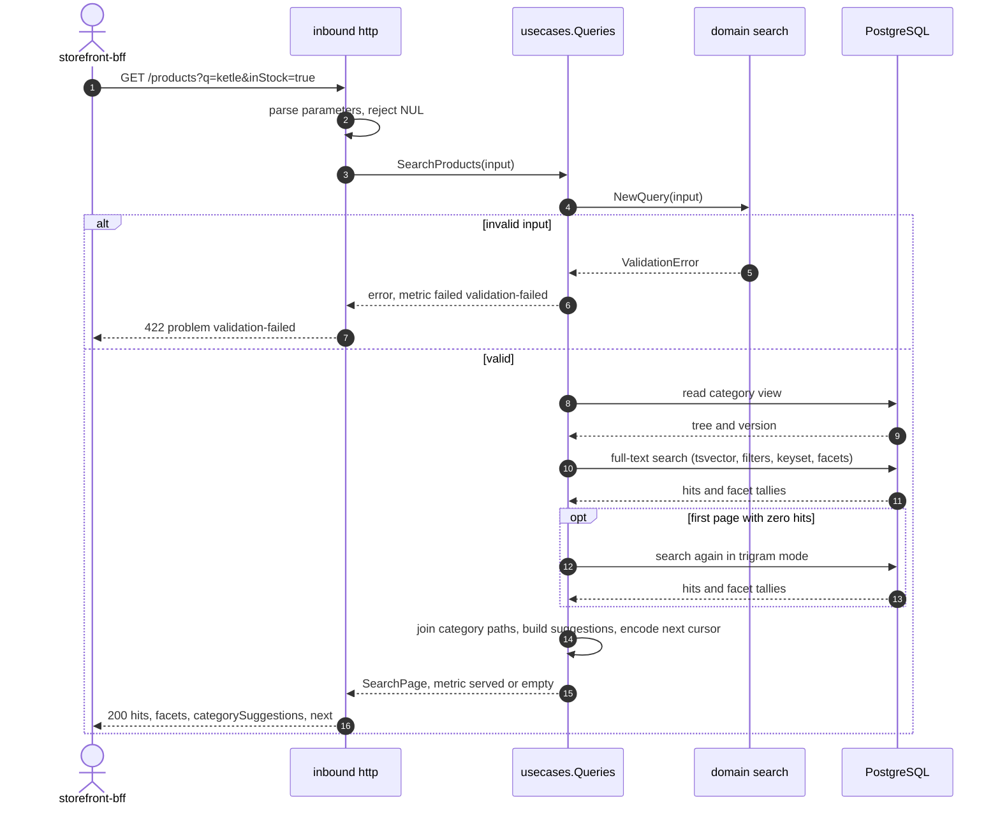
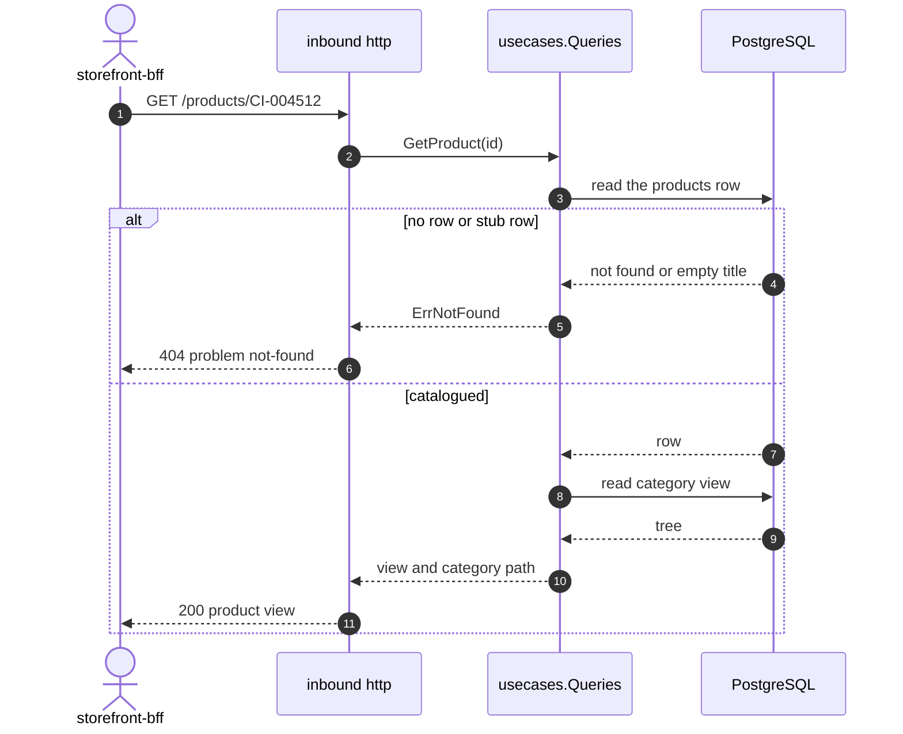
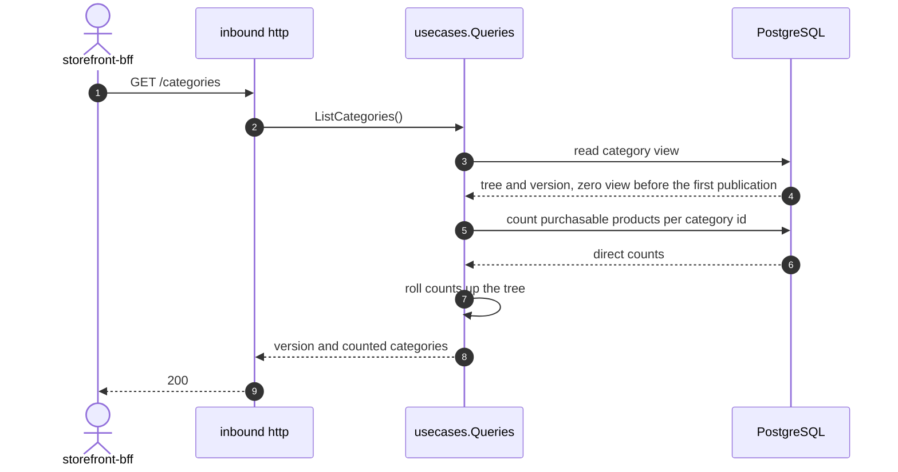
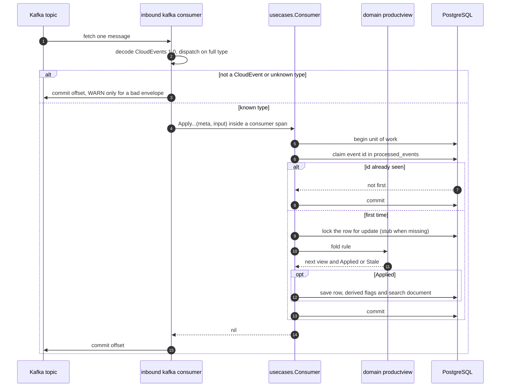
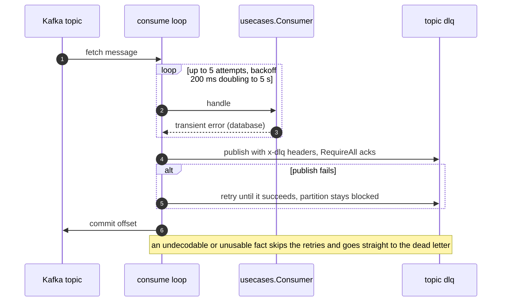
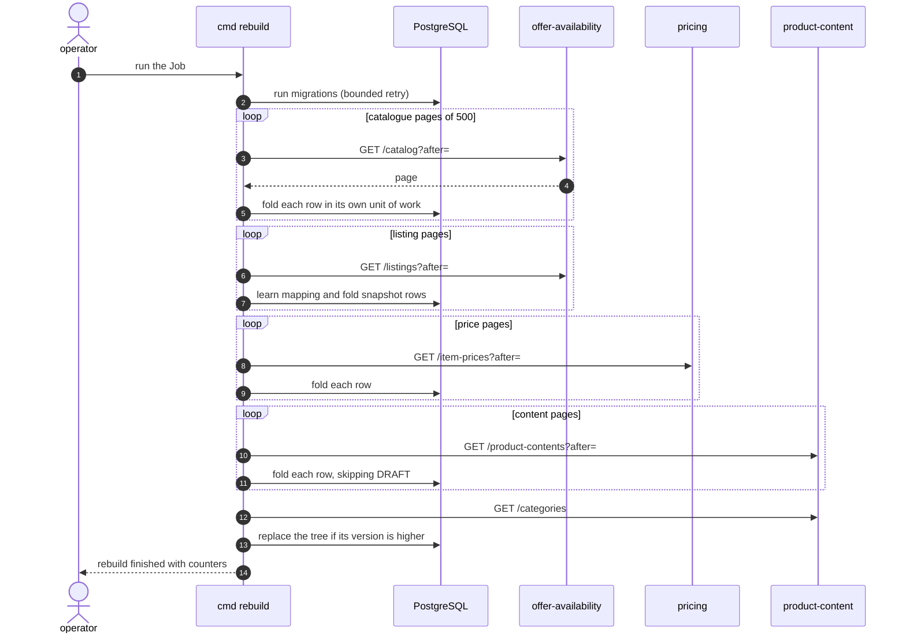
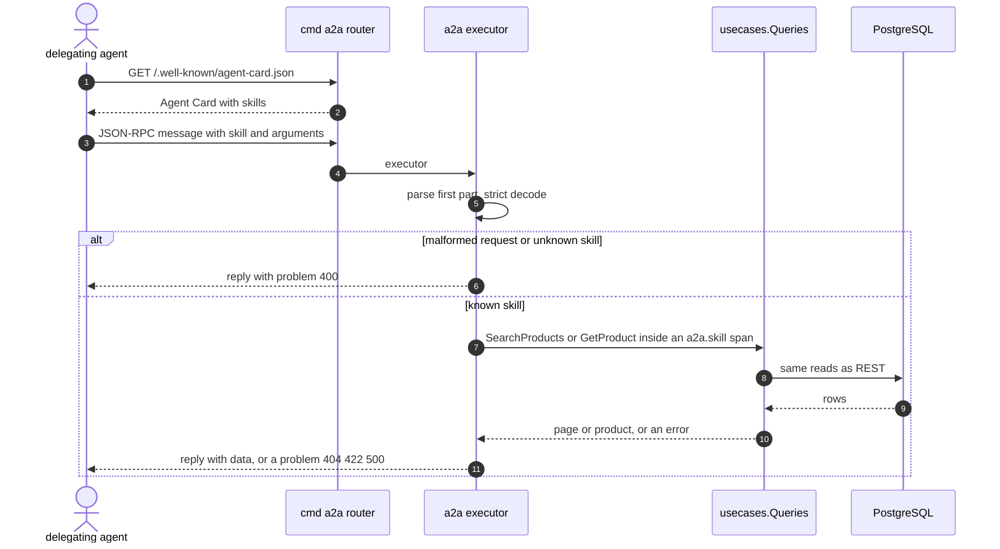

# Sequence diagrams

Adapter to store for every use case, including the failure branches. The participants are the real packages;
Postgres is one database. A2A skills follow the same paths as the REST reads they mirror.

## SearchProducts

Source: `internal/application/usecases/queries.go`, `queries_metrics.go`, `internal/adapters/inbound/http/handlers.go`.

## GetProduct

Source: `internal/application/usecases/queries.go`, `internal/adapters/inbound/http/handlers.go`.

## ListCategories

Source: `internal/application/usecases/queries.go` (`ListCategories`).

## Fold of a consumed event

Source: `internal/adapters/inbound/kafka/{consumer,tracing,kafka}.go`, `internal/application/usecases/consume.go`.
A serialization failure re-runs the unit of work up to 5 times.

## Failure: retry and dead letter

Source: `internal/adapters/inbound/kafka/kafka.go` (`handleWithDeadLetter`, `retryUntilOK`), `deadletter.go`.

## RebuildProjections

Source: `internal/application/usecases/rebuild.go`, `cmd/rebuild/main.go`. A page that fails after 4 attempts
aborts the run (`rebuild failed`, exit 1).

## A2A skill call

Source: `internal/adapters/inbound/a2a/{server,skills}.go`, `cmd/a2a/router.go`.
