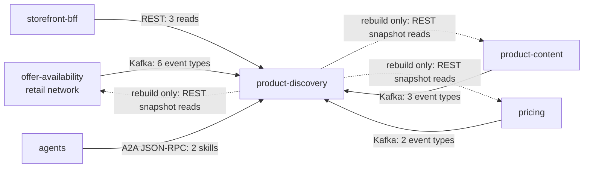

# Integration

Who talks to `product-discovery`, over which protocol, with which contract, and what happens when the other
side is down. The service is a pure consumer of events and a pure server of reads: it publishes no event and
calls no service on a user request. The only outbound HTTP calls are the rebuild job's snapshot reads.

Source: `internal/adapters/inbound/kafka/*.go`, `internal/adapters/outbound/sources/*.go`,
`docs/network-ohs-allowlist.yaml`, `apis/asyncapi.yaml`, `apis/openapi.yaml`.

Source: `cmd/api/workers.go`, `cmd/rebuild/main.go`, `cmd/a2a/router.go`.

## Upstream: events consumed

All three topics are consumed by `cmd/api`, one consumer group per topic, CloudEvents 1.0 structured JSON only.
The relationship with each producer is **Conformist**: the service applies the published contract, keeps only
the fields it needs and ignores unknown ones. Messages are keyed by `catalogItemId` for item, content and
price events and by `listingId` for listing events, so the facts of one key are ordered.

| Producer | Topic | Consumer group variable | CloudEvents types consumed | Contract |
| --- | --- | --- | --- | --- |
| `offer-availability` (retail network) | `retailnetwork.offer-availability.events` | `OFFER_AVAILABILITY_CONSUMER_GROUP` | `com.retailnetwork.commerce.offer-availability.catalogitem.CatalogItemCreated`, `...catalogitem.CatalogItemDiscontinued`, `...listing.ListingCreated`, `...listing.ListingAvailabilityChanged`, `...listing.ListingSuppressed`, `...listing.ListingRestored` | `apis/asyncapi.yaml`, [Events](/docs/api-reference/events) |
| `product-content` | `retailnetwork.product-content.events` | `PRODUCT_CONTENT_CONSUMER_GROUP` | `com.retailnetwork.storefront.product-content.productcontent.ProductContentPublished`, `...productcontent.ProductContentRetired`, `...categorytree.CategoryTreePublished` | same |
| `pricing` | `retailnetwork.pricing.events` | `PRICING_CONSUMER_GROUP` | `com.retailnetwork.storefront.pricing.itemprice.ItemPriceChanged`, `...itemprice.ItemPriceWithdrawn` | same |

Failure behaviour (details in the [Runbook](/docs/operations/runbook#kafka-topics-consumer-groups-and-dead-letters)):

| Situation | Behaviour |
| --- | --- |
| Producer is down or silent | Nothing arrives; the read model keeps serving what it has. The data ages, there is no staleness marker and no alert on a silent topic. Readiness does not depend on topics or lag |
| Topic does not exist yet | `/readyz` stays 200 (readiness asks the broker for metadata and names no topic). The kafka-go reader keeps retrying inside the consumer; this service sets no reader logger, so nothing is written to the log for it |
| Message is not a CloudEvent | WARN, skipped and committed |
| Unknown `type` | Ignored silently, committed |
| Known type, undecodable or unusable `data` | Dead-lettered at once to `<topic>.dlq` |
| Database error while folding | Retried with backoff (200 ms doubling to 5 s) up to 5 attempts, then dead-lettered |
| Duplicate delivery | The CloudEvents `id` is already in `processed_events`: acknowledged without effect |
| Out-of-order delivery | Per-source guards (listing `asOf`, content `revision`, price `version`, tree `version`) drop anything not newer; a fact for an unannounced item creates an invisible stub that `CatalogItemCreated` completes |
| `ListingSuppressed` or `ListingRestored` for an unknown listing | WARN `listing state fact skipped: listing unknown`, acknowledged, repaired by a rebuild |
| Broker lost | Fetch errors are retried up to 10 times, then the consumer returns and the process exits non-zero |

The service never produces to a business topic. Its only producer is the dead-letter writer (hash balancer
on the original key, `RequireAll` acks, topic auto-creation). Kafka is one broker platform-wide; the service
needs `KAFKA_BROKERS` to be reachable from the pod.

## Upstream: snapshot reads on rebuild

`cmd/rebuild` is the only code that makes outbound HTTP calls. The storefront consumes the retail network's
Open Host Service routes only and never a restricted route; the allowlist
`docs/network-ohs-allowlist.yaml` names every call and `TestNoInOrgNetworkRoute` fails the build on any other.

| Service | Call | Kind | Used for |
| --- | --- | --- | --- |
| `offer-availability` | `GET /catalog` (paged) | OHS route | item master rows, including discontinued state |
| `offer-availability` | `GET /listings` (paged) | **ops-only exception**: no storefront read exists for listing availability, so the in-org read is allowed on the rebuild path only, never on a user request | listing state, quantity, `asOf` |
| `pricing` | `GET /item-prices` (paged) | storefront route | prices, `version` |
| `product-content` | `GET /product-contents` (paged) | storefront route | published and retired content, `revision` |
| `product-content` | `GET /categories` | storefront route | the tree and its `version` |

Pages hold 500 rows (`after` cursor, `limit`). Each call is tried 4 times on transport errors and 5xx answers
with a growing pause (200 ms times the attempt) and has a 30 s timeout; any other non-200 answer fails the
run at once. The base URLs are `OFFER_AVAILABILITY_URL`, `PRICING_URL` and `PRODUCT_CONTENT_URL`. A failing
page aborts the run; re-running is safe. The routes are called with no credentials.

## Downstream: REST consumers

| Consumer | Contract | Notes |
| --- | --- | --- |
| `storefront-bff` (experience layer) | `GET /products`, `GET /products/{catalogItemId}`, `GET /categories` per `apis/openapi.yaml`; this context is the Open Host Service | The BFF reaches the service at its in-cluster address (`productDiscoveryUrl` in `warehouse-infra` `helm-values/storefront-bff.yaml`). Through the edge the routes are under Kong `/api/product-discovery` with the prefix stripped. Unauthenticated |
| Other callers | the same three routes | none known; no other context depends on this one because nothing is published |

If this service is down, the BFF's discovery calls fail; the producers and the other storefront contexts are
unaffected.

## Downstream: agents (A2A)

`cmd/a2a` serves the read-only Agent2Agent agent for delegating agents: JSON-RPC 2.0 over HTTP on `/` and
`/a2a`, the Agent Card at `/.well-known/agent-card.json`, two skills (`search_products`, `get_product`).
Through the edge the agent is under `/api/a2a/product-discovery` (rewritten to `/`) when `a2a.route.enabled`
is set; `warehouse-infra` enables it. A2A is a delegation channel, not a data-sync channel: facts between
contexts still travel as CloudEvents on Kafka ([ADR 0007](/docs/adr/0007-a2a-inbound-adapter)). The agent makes
no outbound call. Details: [API overview](/docs/api-reference#a2a-agent).

## Absent edges

Stated so nobody looks for them:

- **No published events**: no outbox, no relay, no `retailnetwork.product-discovery.events` topic, no analytics
  topic. Nothing in the fleet can subscribe to this context.
- **No MCP server** (`cmd/mcp` does not exist).
- **No call to the warehouse-systems fleet**: the context never consumes a `warehouse.*` topic and never calls
  a WMS or WES service.
- **No call to `shopping-cart`, `checkout` or `customer-payments`**, and none from them: the cart keeps its own
  purchasability view from the same feeds.
- **No authentication** on any inbound surface, and no credentials on the rebuild's outbound calls.
- **No synchronous call on a user request**: reads are answered from Postgres alone.

## Discrepancies found

- `warehouse-infra` `helm-values/product-discovery.yaml` and `terraform/apps.yaml` describe the service as
  "api + outbox relay + consumers". The code has no outbox and no relay (ADR 0002 A13); the comment is stale.
- The Grafana alert rules for this context link to `docs/operations/runbook.md` on GitHub; that page now lives
  under `docs/docs/operations/runbook.md` and on this site at `/docs/operations/runbook`.
