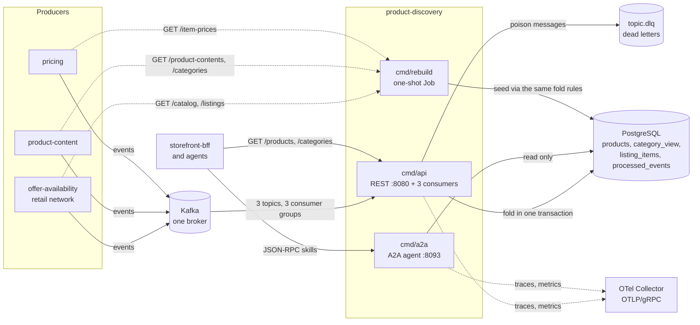

# Architecture

`product-discovery` is a hexagonal (ports and adapters) Go service. Dependencies point inward only; the
composition roots in `cmd/` are the only place that wires layers together. The service is a CQRS read side:
Kafka facts go in through the consumers and become rows in two projections, three REST routes (and two A2A
skills) read them back out. It publishes nothing.

## Containers

Source: `cmd/api/main.go`, `cmd/api/workers.go`, `cmd/a2a/main.go`, `cmd/rebuild/main.go`,
`charts/product-discovery/templates/`.



### Binaries

| Binary | Role | Port | Probes | Needs |
| --- | --- | --- | --- | --- |
| `cmd/api` | REST adapter for `GET /products`, `GET /products/{catalogItemId}`, `GET /categories`, `GET /healthz`, `GET /readyz`; three Kafka consumers (offer-availability, product-content, pricing), always on; embedded migrations at boot. Exits non-zero when a consumer stops so the orchestrator restarts it | `:8080` (`HTTP_ADDR`) | startup and liveness `/healthz`, readiness `/readyz` | Postgres, Kafka |
| `cmd/a2a` | Read-only Agent2Agent agent: JSON-RPC 2.0 on `/` and `/a2a`, Agent Card at `/.well-known/agent-card.json`, `/healthz`. Two skills over the same read use cases as REST. No consumer, no Kafka, no write | `:8093` (`A2A_ADDR`) | `/healthz` for all three | Postgres |
| `cmd/rebuild` | Ops job: pages the producers' snapshot reads and folds them into the projections through the same fold rules, then exits. Never runs on a user request | none | none | Postgres, the three producers' HTTP APIs |

There is no `cmd/mcp`: the context has no MCP server. One image carries all three binaries under `/app` with
entrypoint `./api` (`Dockerfile`).

## Layers

```text
cmd/api, cmd/a2a, cmd/rebuild        composition roots: env, wiring, signals, shutdown order
internal/
  domain/                            pure: no I/O, no clock, imports only other domain packages
    productview/                     ProductView value + fold rules (Apply...), PurchasableRule
    categoryview/                    CategoryView: tree, version guard, counts, name matching
    search/                          Query, Cursor, Bands, Facets, trigram similarity
    shared/                          ValidID, ErrInvalidFact
  application/                       depends on domain and itself only
    usecases/                        Queries (3 reads), Consumer (folds), Rebuilder
    ports/                           interfaces only: repositories, UnitOfWork, Inbox, SearchPort, sources, SearchMetrics
    readmodel/                       data carried across the ports (SearchRequest, Hit, snapshot rows)
  adapters/
    inbound/
      http/                          chi router, DTOs, RFC 9457 problems, readiness gate
      kafka/                         consumers: CloudEvents decode, dispatch, retry, dead letters, consumer spans
      a2a/                           Agent Card, skill dispatch, strict argument decoding
      requestlog/                    access-log middleware
    outbound/
      postgres/                      repositories, unit of work, search SQL, migrations, pool
      kafka/                         broker reachability check (readiness)
      sources/                       HTTP clients of the rebuild (offer-availability, pricing, product-content)
      telemetry/                     OTLP setup, slog trace correlation, discovery.searches.served
      memory/                        in-memory doubles: tests only, never imported by cmd/
    kafka/cloudevents/               the single CloudEvents 1.0 decode helper
  architecture/                      fitness tests (arch-go and source scanners)
  bootretry/                         bounded boot retry for migrations and the first ping
  bdd/, testing/                     godog runner, testcontainers helpers
```

Source: `internal/architecture/architecture_test.go`.

### Rules enforced by `internal/architecture`

| Rule | Test |
| --- | --- |
| Domain depends on nothing internal except domain | `TestHexagonalArchitecture` |
| Application depends only on domain and application | same |
| Inbound adapters never depend on outbound adapters, and the reverse | same |
| Only `cmd` is the composition root wiring every layer | same |
| `ports` contains only interfaces | same |
| The A2A adapter depends inward only and never writes | `TestA2AAdapterDependencyRule`, `TestA2ASourcesStayReadOnly` |
| No auth middleware is reintroduced | `TestNoAuthMiddlewareReintroduced` |
| CloudEvents 1.0 only, no envelope toggle, catalogue matches `apis/asyncapi.yaml` | `TestCloudEventsOnly`, `TestNoEventEnvelopeToggleOrFlatEnvelope`, `TestEventCatalogueMatchesContract` |
| Binaries never import the memory adapters; no Go file at the module root | `TestRuntimeBinaryHasNoInMemoryAdapters`, `TestNoGoFilesAtRepoRoot` |
| Outbound HTTP calls stay on `docs/network-ohs-allowlist.yaml` | `TestNoInOrgNetworkRoute` |

See [Testing](/docs/development/testing#architecture-fitness-tests) for the full list.

## Data flow

**Write path (events to rows).** One consumer per topic reads one message at a time. It decodes the
CloudEvents 1.0 envelope, dispatches on the full `type`, and runs `usecases.Consumer` inside one Postgres
transaction (`UnitOfWork.Do`): claim the event `id` in `processed_events`, lock the product row for update
(an advisory lock per item, which also covers an item with no row yet), apply the pure fold rule, save the
row with its recomputed `in_stock`, `purchasable`, `searchable` and search document. A serialization failure
is retried up to 5 times; the offset is committed only after the transaction. Three consumer groups write
concurrently, which is why every read-modify-write goes through `GetForUpdate`.

**Read path.** `Queries.SearchProducts` validates the input, reads the current category tree, builds a
`SearchRequest` (browse, full-text or trigram mode), runs it through the `SearchPort`, retries once in trigram
mode if a first full-text page found nothing, and joins category paths from the tree. `GetProduct` and
`ListCategories` read the rows and the tree. Reads run outside any transaction, write nothing, and are safe
to load-balance. Price bands are computed at query time from `PRICE_BAND_EDGES`, nothing is stored.

**Rebuild path.** `cmd/rebuild` runs migrations, then folds the catalogue, listings, item prices, product
contents and category tree in that order, 500 rows per page, each row in its own unit of work and through the
same fold rules, so the per-source guards make the overlap with live events safe.

## Data stores

| Store | What | Owner |
| --- | --- | --- |
| PostgreSQL (one database, one migration `0001_product_discovery_schema`, embedded in the binary) | `products` (one row per item, with `listings`, `bullets`, `attributes`, `media` as JSONB and a weighted `tsvector` `doc`), `category_view` (singleton row: version plus the tree as JSONB), `listing_items` (listing to item lookup), `processed_events` (inbox), the `pg_trgm` extension and the search indexes | written by `cmd/api` and `cmd/rebuild`, read by `cmd/api` and `cmd/a2a` |
| Kafka | three consumed topics and their `.dlq` topics; nothing else | the producers own the topics; the service writes only dead letters |

There is no cache, no outbox table and no second search engine. Postgres is accessed through a pool of at
most 10 connections per process with a 5 s statement timeout. Schema detail: [Entity relationship](/docs/ddd/entity-relationship).

## Cross-cutting

- **Idempotency and ordering.** Inbox on the CloudEvents id, plus per-key monotonic guards (listing `asOf`,
  content `revision`, price `version`, tree `version`); events may arrive in any order across keys.
- **Failure handling.** Transient failures retry with capped backoff (200 ms doubling to 5 s) up to 5
  attempts, then the message goes to `<topic>.dlq`; unusable facts go there at once. A lost broker ends the
  process after 10 consecutive fetch failures. See the [Runbook](/docs/operations/runbook).
- **Shutdown order** (`cmd/api`): readiness flips to 503, wait `SHUTDOWN_DRAIN_DELAY`, drain HTTP (10 s), stop
  and await the consumers (10 s each), close the pool, flush telemetry.
- **Observability.** JSON logs with trace correlation, OTLP traces and metrics, one business counter. See
  [Observability](/docs/operations/observability).
- **No authentication** on REST or A2A, fleet-wide.
